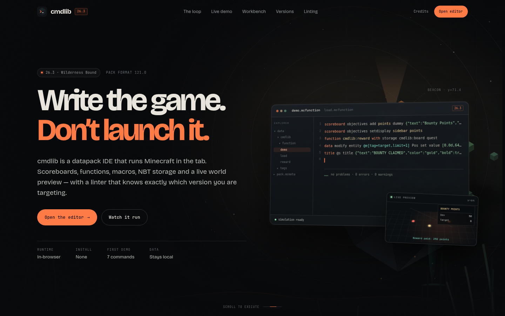
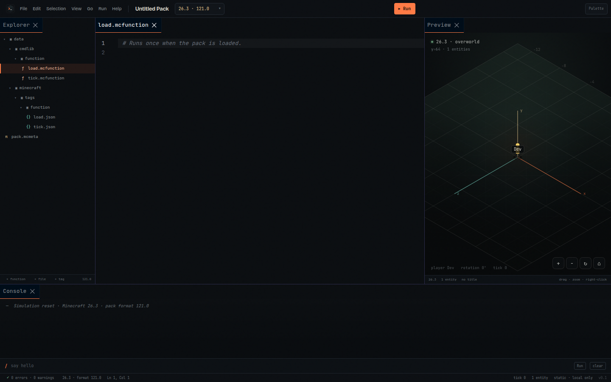
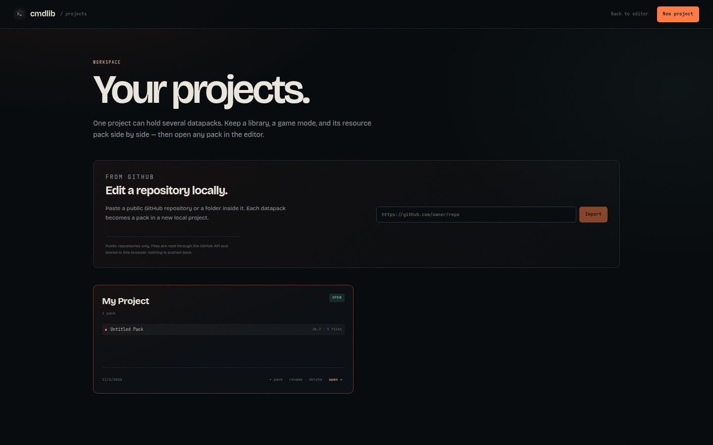
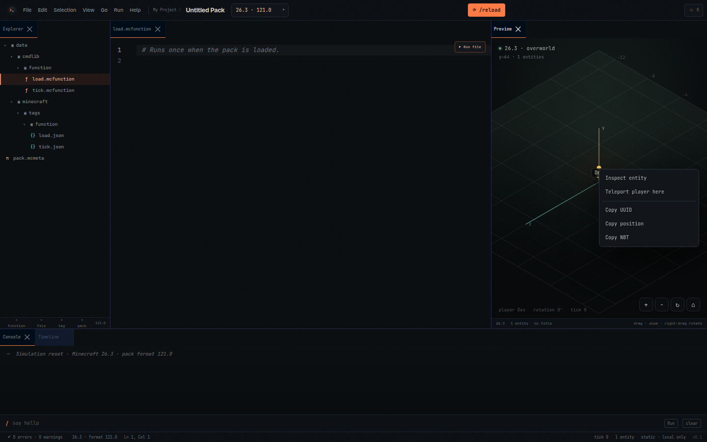
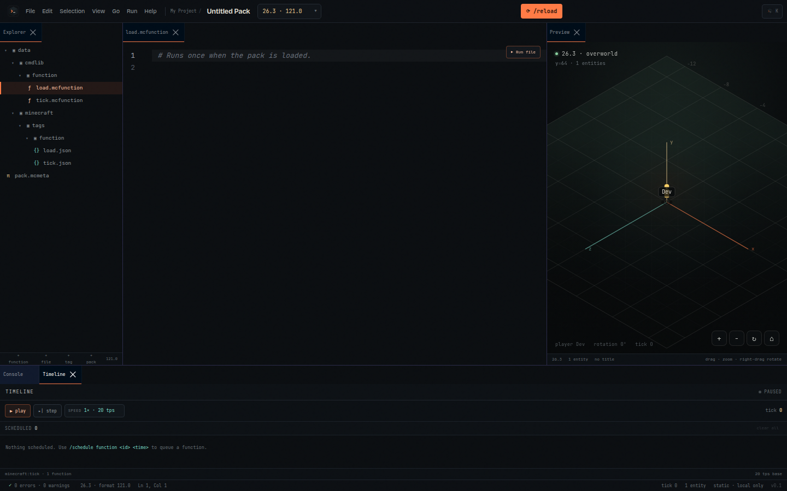

# cmdlib

**Write the game. Don't launch it.**

cmdlib is a browser-native Minecraft datapack IDE. It gives you a dockable
workbench, a real command runtime that runs in the tab, an isometric world
preview, and a version-aware linter. The first demo targets **Minecraft Java
Edition 26.3 (Wilderness Bound, data pack format 121.0)** and the version table
also carries the 1.13 → 1.21.10 lineage.

No Minecraft process, no server, no telemetry. The static site can be hosted on
any file server.







---

## Quick start

```bash
npm install
npm run dev          # http://localhost:3000
npm run build        # static export in ./out
npm test             # engine + lint + autocomplete tests
```

## Live site

- **Site:** https://cmdlib.kalalib.com/
- **GitHub Pages:** https://gameboy612.github.io/cmdlib/ (redirects to the custom domain)
- **Source:** https://github.com/Gameboy612/cmdlib

The site is a static export deployed to the `gh-pages` branch by
[`.github/workflows/deploy.yml`](.github/workflows/deploy.yml). The project site
uses the custom domain `cmdlib.kalalib.com`, which serves at the domain root, so
the workflow builds with an empty base path and
`NEXT_PUBLIC_SITE_URL=https://cmdlib.kalalib.com`. Local builds keep the root
path as well.

---

## Projects

Open `/projects/`. A project groups one or more datapacks (packs); files stay in
the browser. You can create, rename and delete projects (including from a
right-click menu), add packs to a project, import a `.zip` project (which may
contain one or more datapacks), or paste a public GitHub repository/folder URL
and import every datapack it contains.

## Editor

Open `/editor/`. The starter pack is already loaded:

1. **/reload** reloads the pack and runs `#minecraft:load`.
2. **Run file** at the editor's top-right runs the active function.
3. `tick.mcfunction` is wired to `minecraft:tick`; open **Timeline** to
   play/pause, step, or change tick speed. `/schedule function` and
   `/schedule clear` are simulated.
4. Type a command in the console, for example `say hello`.
5. The command palette is the **cmdlib mark + K** button, or
   `Ctrl/Cmd + K`.
6. `Ctrl/Cmd + Space` opens editor autocomplete; `Tab` accepts the active suggestion. The console has its own **Tab autocomplete** for commands, selectors, objectives, functions, storage and NBT paths.
7. In the command palette (`Ctrl/Cmd + K`), type a function id such as `cmdlib:stats` to jump straight to its file.
8. Right-click a file or folder for **Open / Run function / Rename / Duplicate /
   Delete / Copy path**; right-click a dock tab for close/float/maximize;
   right-click an entity in the preview for **Inspect / Teleport / Copy NBT**.
   Right-drag the preview to rotate it.
9. Create, rename and delete files inline in the Explorer — no browser dialogs —
   and drag files between folders to move them. Multiple files stay open in the
   editor tab strip; closing all leaves the Code panel open.
10. **File → Preferences** records custom keybindings. **View** ticks panels that
   are already open.
11. New packs are added beside the current pack, not instead of it. **+ tag**
    creates function, item, block, entity type, fluid or game event tags;
    **File → New predicate** scaffolds a predicate JSON file.
12. Scores are clamped to Minecraft's signed 32-bit range
    (`-2,147,483,648 … 2,147,483,647`) and list 50 holders per page.





Everything is stored in `localStorage`. **File → Export** writes a standard
datapack `.zip`; **File → Import** reads one back.

---

## What the first demo supports

| Area | Commands | Notes |
| --- | --- | --- |
| Scoreboards | `scoreboard objectives add/remove/list/modify/setdisplay`, `scoreboard players set/add/remove/reset/get/operation/display` | Criterion validation, display slots, sidebar HUD, signed 32-bit bounds, paginated inspector |
| Titles | `title … title/subtitle/actionbar/times/reset/clear` | Text components with style inheritance, score/selector resolution, timed fades |
| Functions | `function <id>`, `function <id> {…}`, `function <id> with storage/entity/block …` | Function tags, recursion limit, 65 536-command chain cap |
| Macros | `$` lines with `$(key)` interpolation, `$$(` escaping | Missing arguments and newline injection are rejected |
| Data | `data get/modify/merge/remove` on `storage`, `entity`, `block` | `set/merge/append/prepend/insert/remove`, `value/from/string` sources, NBT paths with indexes and filters |
| Storage | `data storage` namespaces | Live storage inspector and NBT tree |
| Execute | `as`, `at`, `positioned`, `align`, `rotated`, `facing`, `in`, `anchored`, `if`/`unless`, `store`, `run` | `if score`, `if entity`, `if block`, `if data`, `if dimension`, `if loaded`; eyes/feet anchors |
| Entities | `summon`, `kill`, `teleport`/`tp`, `tag` | Static objects with position + NBT; **no AI and no physics** |
| Player state | `gamemode`, `give`, `clear`, `effect give/clear`, `scoreboard players enable`, `trigger`, `spectate` | Simulated game mode, inventory, effect durations, trigger objectives and spectate targets; effects work on any entity |
| Predicates | `execute if predicate`, `execute unless predicate` | `data/<ns>/predicate/*.json`; references, all_of/any_of, entity/location/score/time/value/random conditions |
| Chat | `say`, `tellraw`, `me` | Rendered with Minecraft colour codes and component styles |
| Scheduling | `schedule function`, `schedule clear` | Tick queue driven by the Timeline; `t`/`s`/`d` durations |
| Misc | `return`, `return run`, `setblock`, `reload` | `return` stops a function with a value |

### Deliberately not simulated

`particle`, `playsound`, `loot`, `advancement`, `worldborder`, `bossbar` and the
other commands outside the table above are **recognised by the linter** with
their 26.3 metadata. The runtime logs a **warning** and continues with the next
line of the function, so one unsupported command cannot stop a setup or tick
chain.

Very large projects use a bounded lint pass. If a project exceeds the lint
budget, the editor reports a `lint-truncated` warning instead of freezing or
crashing; files stay editable.

Entities are not game entities in the AI sense. They are objects:

```text
{ uuid, type, nbt: CompoundTag }
```

`Pos`, `Rotation`, `Health`, `CustomName`, `Tags` and the rest of the entity NBT
are the source of truth. Change `Pos` with `data modify` and the preview moves
the entity. Nothing ticks until you start the Timeline (or run `/schedule`).

---

## Architecture

```text
src/lib/mc/
  nbt.ts           tagged NBT model + SNBT printer
  snbt.ts          SNBT parser (compounds, lists, typed arrays, escapes)
  nbtPath.ts       NBT paths: keys, indexes, [] wildcards, [{…}] filters
  text.ts          text component rendering (styles, score, selector, nbt)
  version.ts       version profiles + folder/pack.mcmeta migration
  data.ts          curated 26.3 registries + command metadata
  world.ts         world state: objectives, scores, storages, entities, titles
  selectors.ts     @s @p @a @e @r @n, filters, sorting, limits
  cursor.ts        command cursor + diagnostics with source offsets
  commands/        scoreboard, title, function, data, execute, player, schedule, core
  simulator.ts     function loading, macro expansion, load tags, ticks, scheduling
  datapack.ts      pack parsing, starter/landing packs, tags, objectives
  tag-kinds.ts     function/item/block/entity/fluid/game-event tag metadata
  projects.ts      project → multiple packs workspace model

src/lib/lint/      project-wide lint pass using the real parser
src/lib/editor/    mcfunction language, completion engine, CodeMirror setup
src/lib/state/     zustand workbench, projects, preferences, simulator lifecycle
src/components/    landing, projects, editor, world preview, NBT tree
```

The **simulator is not a second implementation of the grammar**. The linter
executes each line against a sandbox `World`, so a rule can only be as accurate
as the runtime. Diagnostics therefore line up with what actually happens.

### Lint rules

- Unknown commands, unknown objectives, unknown functions and tags.
- Missing macro arguments at a call site; macro functions called without args.
- Invalid NBT, invalid NBT paths, wrong modify targets, append-to-non-list.
- Pack format mismatch, missing `min_format`/`max_format`, legacy folders.
- Version-gated commands: `/compute`, `/posteffect`, `execute if items/slots`
  (26.3), `return` (1.20.2+), macros (1.20.2+).
- Function tag cycles and references to missing functions.
- Warnings for recognised-but-not-simulated commands (not errors).
- Info for unused functions and undisplayed objectives.

Diagnostics export as **LSP-compatible JSON** from the Problems panel. See
[`docs/LICENSING.md`](docs/LICENSING.md) for the tooling audit and credits.

---

## Versions

Versions are profiles, not branches. A profile declares:

```ts
{
  id: "26.3",
  packFormat: [121, 0],
  functionFolder: "function",
  tagFolder: "tags/function",
  packMeta: "minmax",
  macros: true,
  textComponents: "snbt",
  dataVersion: 5023,
  protocol: 777
}
```

Switching the target in the toolbar migrates:

- `functions` ↔ `function`
- `tags/functions` ↔ `tags/function`
- `pack_format` ↔ `min_format` / `max_format`
- the active file path and every open tab

Then the whole pack is linted against the new profile. To add 26.4, add one
row to `VERSIONS` (`src/lib/mc/version.ts`); no editor code has to change.

> Pack format numbers are taken from the Minecraft Wiki's pack format history
> and Mojang release metadata. The 26.3 profile is data format **121.0**, data
> version **5023**, protocol **777**.

---

## Design

The landing page was built against the workflow in
[`scroll-craft`](https://github.com/nateherkai/scroll-craft) (MIT), adapted for
a developer tool. The brief, feeling curve, peak and signature move are in
[`docs/BRIEF.md`](docs/BRIEF.md).

The signature move is **scroll-as-tick**: the pinned “Scroll is the tick”
section runs the actual cmdlib simulator, one command per scroll threshold.
The scoreboard, the macro expansion, the moved entity and the final title are
produced by the same engine the editor uses.

All art is original and generated by `scripts/generate-art.mjs`: layered
isometric hero plates, the mark, the favicon and the OG card. No Minecraft
textures, sounds or models are redistributed.

---

## Licensing

cmdlib is intended to be a paid product. The policy is:

- **Commercial-use compatible only.** MIT, ISC, Apache-2.0 and OFL-1.1 are
  allowed with attribution. GPL, AGPL, SSPL and non-commercial-only assets are
  not bundled.
- **No Minecraft assets.** No textures, sounds, models, fonts or wiki prose.
- **Linter credit.** Rule semantics are modelled on Spyglass (MIT) and mclint
  (ISC); neither is vendored or copied. The linter and runtime are original
  TypeScript.
- **Full notices.** [`public/THIRD_PARTY_NOTICES.txt`](public/THIRD_PARTY_NOTICES.txt)
  is generated by `npm run notices`; [`/credits/`](src/app/credits/page.tsx)
  is the human-readable audit.

See [`docs/LICENSING.md`](docs/LICENSING.md) for the audit table and
[`LICENSE`](LICENSE) for the project license status.

Minecraft is a trademark of Mojang Synergies AB. cmdlib is not affiliated with
Mojang Studios or Microsoft.

---

## Testing

```bash
npm test
```

The suite covers:

- SNBT parse/print, typed arrays, path resolution and modify modes.
- The full starter pack load and the demo function (scoreboards, macro
  expansion, storage, `execute store`, NBT position changes, titles).
- Lint diagnostics for unknown objectives/functions, missing macros, version
  gates, pack metadata and LSP output.
- Context-aware autocomplete for scoreboards, functions, data, execute,
  selectors and summon.

Visual verification is done with Playwright at desktop and mobile widths
(`scripts/qa*.mjs`). The scripts are not part of the production build.

---

## Scripts

| Script | Purpose |
| --- | --- |
| `npm run dev` | Next.js dev server |
| `npm run build` | static export to `out/` |
| `npm test` | Vitest engine/lint/completion suite |
| `npm run typecheck` | `tsc --noEmit` |
| `npm run notices` | regenerate third-party notices |
| `node scripts/generate-art.mjs` | regenerate hero/OG art |

---

## Status

The first demo is intentionally narrow: **26.3 scoreboard values, titles,
functions, data get/modify, macros and storage**. The next layers are richer
entity simulation (inventory, attributes, poses), scheduled functions, and a
larger command set once the preview can honestly represent the result.
